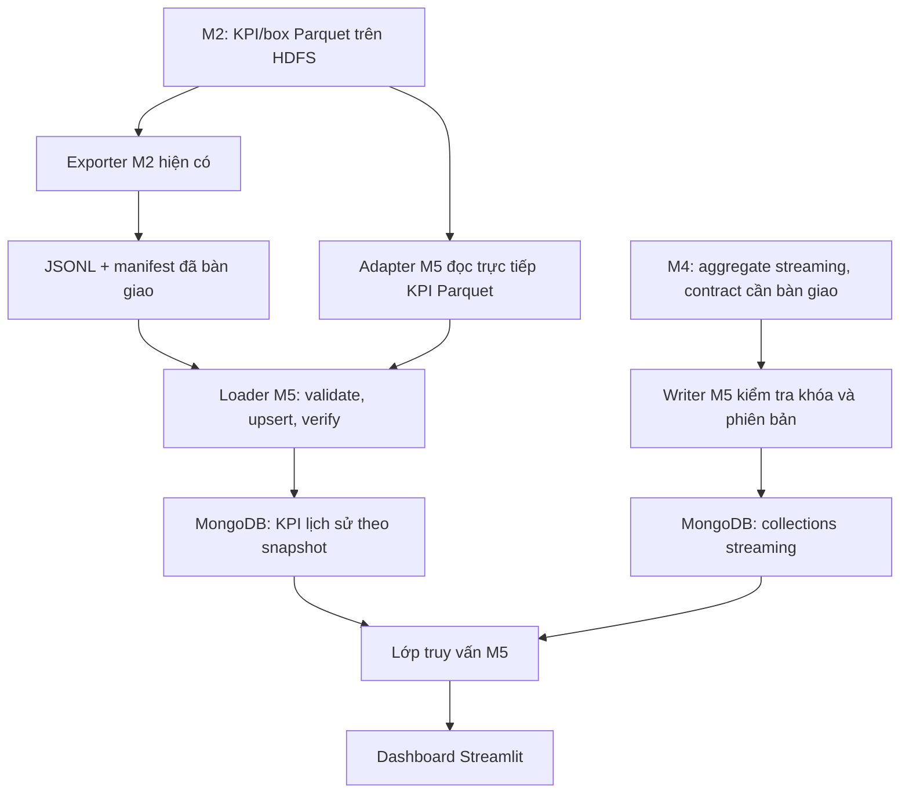

# Kế hoạch implement M5 — MongoDB, Serving và Dashboard

Ngày lập: 07/11/2026. Đây là kế hoạch gốc. Phần batch serving, dashboard,
scripts và adapter đã được implement; trạng thái chạy và cách vận hành xem
[README M5](../README.md) và [hướng dẫn M5](HUONG_DAN_CHAY_M5.md).
Streaming vẫn cần M4 tích hợp; deployment cuối cần đích triển khai được chốt.

## 1. Mục tiêu và căn cứ

M5 nhận KPI lịch sử từ M2 và KPI streaming từ M4, nạp vào MongoDB, phục vụ truy
vấn và hiển thị dashboard. Đầu ra gồm code tái lập được, collections/indexes,
dashboard, kiểm thử đối chiếu và kịch bản demo.

Căn cứ trong repo:

- [Tài liệu phân công](../../Big_Data_Project_Plan_5_Members.pdf), trang 6–8:
  hợp đồng M4 → M5, trách nhiệm M5 và tích hợp/deployment.
- [Hợp đồng M2 → M5](../../batch-layer/doc_guide/HUONG_DAN_BAN_GIAO_M2_M5.md).
- Manifest đã có tại
  `batch-layer/spark_jobs/export/m2_to_m5/20261107T042703414867Z/manifest.json`.
- Notebook `batch-layer/spark_jobs/eda_lite.ipynb`: định nghĩa KPI thực tế.

Khi lập plan, repo có HDFS/Spark và bộ output M2. Code serving/dashboard đã
được bổ sung theo kế hoạch này; vẫn chưa có output M4 để xác nhận tích hợp.

## 2. Dữ liệu đã sẵn sàng

| Nội dung | Giá trị trong manifest hiện tại |
|---|---|
| Phạm vi | 2022-01 đến 2026-03, 51 tháng |
| Tổng chuyến bay trong KPI tháng | 29.328.846 chuyến sau cleaning |
| KPI | 13 bảng, 64.249 dòng tổng hợp |
| Box-plot | 7 bảng, 10.672 dòng tổng hợp |
| Tổng document dữ liệu dự kiến cho một snapshot | 74.921, chưa tính metadata |
| Bộ export | 20 JSONL + 20 CSV + manifest |

Đây là số liệu từ manifest; loader vẫn phải đọc và kiểm tra file thực tế.
MongoDB nhận các bảng tổng hợp. Dữ liệu chuyến bay sạch vẫn được giữ trên
HDFS và trong thư mục `cleaned_parquet_20261107_115337` đã sao lưu.

## 3. Kiến trúc và lựa chọn công nghệ

Triển khai local bằng **Python + PyMongo + MongoDB + Streamlit + Plotly**,
đóng gói bằng Docker Compose. Streamlit có hướng dẫn chính thức kết nối
MongoDB bằng PyMongo và cache kết nối/kết quả truy vấn
([tài liệu](https://docs.streamlit.io/develop/tutorials/databases/mongodb)).
Phiên bản image và dependency sẽ được chọn, ghim và kiểm tra khi implement;
không dùng tag `latest` trong bộ bàn giao.



Dashboard truy vấn MongoDB qua module Python dùng chung. JSONL/CSV là nguồn
cho loader và đối soát, không phải nguồn đọc trực tiếp của các biểu đồ.

Hai cách nạp lịch sử dùng chung quy tắc kiểm tra và ghi MongoDB:

1. **JSONL + manifest:** implement trước, tận dụng bộ output đã kiểm tra.
2. **KPI Parquet trên HDFS:** implement tiếp để chứng minh đúng luồng trong
   sơ đồ dự án. Đọc `/aero/analytics/eda/kpi` và `/aero/analytics/eda/box`;
   không nhầm với Parquet từng chuyến bay ở `/aero/processed`.

## 4. Cấu trúc code dự kiến

```text
serving-layer/
├── compose.yml                     # MongoDB, dashboard, loader theo nhu cầu
├── compose.hdfs.yml                # Job đọc HDFS, nối mạng batch hiện có
├── Dockerfile                      # Môi trường Python của serving
├── Dockerfile.spark-loader         # Spark 3.5.3 + dependency loader
├── requirements.txt                # Dependency được ghim
├── .env.example                    # Tên DB, URI và cấu hình mẫu
├── .gitignore                      # Bỏ qua secrets và output vận hành
├── app.py                          # Điểm khởi động Streamlit
├── m5/
│   ├── config.py
│   ├── mongo.py                    # Kết nối và kiểm tra MongoDB
│   ├── contracts.py                # Manifest, schema, keys, conventions
│   ├── load_batch.py               # CLI nạp JSONL
│   ├── load_parquet.py             # Entry point chạy bằng spark-submit
│   ├── batch_writer.py             # Index, bulk upsert, publish snapshot
│   ├── verify_batch.py             # Đối chiếu nguồn và MongoDB
│   ├── metrics.py                  # Công thức gộp KPI theo M2
│   ├── queries.py                  # Filter, projection, aggregate, sort
│   └── stream_writer.py            # Implement sau khi chốt contract M4
├── views/                          # Các trang dashboard
├── scripts/
│   ├── start_m5.ps1
│   ├── load_m2.ps1
│   ├── verify_m5.ps1
│   ├── load_hdfs.ps1
│   ├── stop_m5.ps1
│   └── collect_evidence.ps1
├── tests/                          # Unit + integration có dữ liệu nhỏ
├── contracts/
│   └── M4_TO_M5.md                 # Phần đã thống nhất và phần còn thiếu
├── logs/
├── evidence/
└── doc_guide/
    ├── KE_HOACH_IMPLEMENT_M5.md
    ├── HUONG_DAN_CHAY_M5.md
    ├── MONGODB_COLLECTIONS_QUERIES.md
    └── KICH_BAN_DEMO_M5.md
```

Compose serving tạo volume MongoDB riêng. Mount output M2 vào loader ở chế độ
chỉ đọc. Dashboard dùng `http://localhost:8501`. Nếu cần truy cập MongoDB từ
Windows, publish cổng trên loopback và ghi rõ URI host khác URI nội bộ Docker.
Thông tin đăng nhập thật không ghi vào Git hoặc log.

Môi trường chạy JSONL/dashboard độc lập với HDFS. Job Parquet chỉ chạy khi
batch stack hoạt động, dùng Spark 3.5.3 và mạng Compose có thể phân giải
`namenode`/`datanode`; kiểm tra tên mạng thực tế khi implement. Tránh chạy
ETL/EDA nặng cùng lúc với loader hoặc demo trên máy ít RAM.

## 5. MongoDB và loader lịch sử

### 5.1. Collections và khóa

Giữ 20 tên collection theo `suggested_collection` trong manifest, ví dụ:

| Collection | Khóa nghiệp vụ |
|---|---|
| `kpi_month_overall` | year, month |
| `kpi_month_carrier` | year, month, carrier |
| `kpi_year_origin` | year, origin |
| `kpi_year_route` | year, origin, dest |
| `box_year_carrier` | year, carrier, var, population |

Mỗi document lịch sử có thêm `snapshot_id`; unique index là tổ hợp
`snapshot_id` và toàn bộ khóa của bảng. MongoDB hỗ trợ unique compound index
để bảo đảm một tổ hợp khóa chỉ xuất hiện một lần
([tài liệu](https://www.mongodb.com/docs/manual/core/index-unique/)).
Thêm index phục vụ truy vấn sau khi kiểm tra filter/sort thực tế bằng explain.

Metadata riêng:

- `batch_runs`: manifest, fingerprint của nguồn, số dòng/bảng, trạng thái,
  thời điểm ingest/verify, thông tin nguồn JSONL hoặc Parquet.
- `serving_state`: một document chỉ snapshot lịch sử đang phục vụ.

### 5.2. Trình tự nạp và công bố

1. Nhận đường dẫn snapshot cụ thể; không tự chọn ngầm thư mục mới nhất.
2. Kiểm tra manifest version, 20 bảng, coverage, keys, schema, tên collection
   cho phép và đường dẫn file nằm trong snapshot.
3. Đọc từng dòng JSONL; kiểm tra kiểu dữ liệu, khóa trùng và số dòng. Giữ số,
   boolean và null; từ chối giá trị không hữu hạn không hợp lệ cho KPI.
4. Tạo fingerprint để nhận biết cùng bộ dữ liệu. Cùng định danh nguồn nhưng
   nội dung thay đổi phải được phát hiện, không cập nhật ngầm snapshot đang dùng.
5. Tạo run chưa công bố, tạo indexes, ghi theo lô dự kiến 1.000 document bằng
   `Collection.bulk_write` và upsert theo khóa. PyMongo có bulk operations để
   gom nhiều thao tác ghi trong một lần gọi
   ([tài liệu](https://www.mongodb.com/docs/languages/python/pymongo-driver/current/crud/bulk-write/)).
6. Đối chiếu tất cả bảng trong MongoDB với nguồn: count, khóa, giá trị, tổng
   flights và KPI mẫu. Ghi báo cáo PASS/FAIL có chi tiết.
7. Chỉ khi tất cả kiểm tra đạt mới cập nhật document con trỏ active snapshot.
   Dashboard chốt một snapshot cho một lượt truy vấn để không trộn các lần nạp.

Snapshot đã công bố là bất biến. Nạp lại đúng fingerprint thì kiểm tra/skip;
retry run chưa công bố có thể upsert tiếp. Nếu nạp lỗi giữa chừng, active
snapshot cũ vẫn phục vụ. Snapshot mới thể hiện toàn bộ trạng thái mới nên dữ
liệu cũ bị loại khỏi nguồn không còn xuất hiện khi truy vấn snapshot mới.
Không tự xóa lịch sử trong lần implement đầu; dọn snapshot cũ là thao tác
riêng có hướng dẫn và luôn giữ snapshot active.

### 5.3. Adapter đọc HDFS Parquet

- Dùng catalog 20 bảng từ hợp đồng, kiểm tra schema/keys/count trước khi nạp.
- Job chạy trong container có cả Spark và PyMongo, kết nối được HDFS và MongoDB.
- Dữ liệu là bảng tổng hợp, có giới hạn số dòng giống exporter. Đọc tuần tự
  bằng iterator, chuyển kiểu Spark/date/timestamp về kiểu BSON hợp lệ và ghi
  theo lô; không `collect()` toàn bộ dữ liệu chuyến bay về driver.
- Ghi provenance của đường dẫn HDFS và thời điểm đọc. Trong lần nạp phải giữ
  các bảng M2 ổn định, không cho ETL/EDA ghi đồng thời; fingerprint cuối phải
  khớp dữ liệu đã kiểm tra.
- Đối chiếu kết quả adapter với JSONL từ cùng lần build bằng khóa và giá trị.
  Bộ Parquet sạch từng chuyến bay không được dùng thay bộ KPI aggregate.

## 6. Dashboard và những bộ lọc thực sự hỗ trợ

| Trang | Nội dung | Nguồn và giới hạn |
|---|---|---|
| Tổng quan | Flights sau cleaning, OTP, delay, hủy/chuyển hướng, xu hướng | `kpi_month_overall`, `kpi_year_overall`, `kpi_day_overall`; lọc thời gian |
| Thời gian và mùa vụ | Ngày/tháng/năm, tháng trong năm, giờ khởi hành | Bảng theo thời gian tương ứng; mùa vụ/giờ toàn kỳ không nhận bộ lọc năm |
| Hãng bay | Ranking, OTP, delay, hủy, reliability score | `kpi_month_carrier`, `kpi_year_carrier`; năm/tháng/hãng |
| Sân bay | Lưu lượng, delay/hủy theo sân bay xuất phát | `kpi_month_origin`, `kpi_year_origin`; năm/tháng/origin |
| Tuyến bay | Ranking và tra cứu origin → dest | `kpi_year_route`; chỉ năm/origin/dest, chưa có tháng |
| Phân phối delay | Box-plot theo tháng/năm/hãng, arr/dep, all/late | 7 bảng box; filter theo đúng chiều có trong từng bảng |
| Streaming | Window KPI, freshness, nguồn API/mô phỏng | Chưa kết nối M4 thì hiện trạng thái chưa có dữ liệu |
| Dữ liệu và vận hành | Snapshot, coverage, số document, lần nạp/verify | `batch_runs`, `serving_state`; không gọi export time là thời điểm thu thập |

Hạn chế phải thể hiện trên giao diện:

- Không áp dụng một bộ lọc toàn cục cho các bảng thiếu chiều lọc đó. Các bảng
  `month_of_year_*`, `calendar_day_overall` đã gộp qua năm; `hour_overall` đã
  gộp toàn kỳ. Muốn lọc khác cần M2 bổ sung bảng hoặc dùng bảng chi tiết hơn
  nếu vẫn có đủ chiều để tính đúng.
- Sân bay hiện chủ yếu là `origin`, không gọi chỉ số này là tổng cả đến và đi.
- Năm 2026 mới có quý 1; so sánh năm dùng cùng kỳ hoặc ghi rõ thiếu kỳ.
- Null hiển thị chưa có giá trị, không tự đổi thành 0. Tỷ lệ nhân 100 khi hiển
  thị phần trăm. Phút đến sớm được giữ âm. Reliability score ghi rõ là điểm
  nhóm tự định nghĩa.
- Mỗi trang hiển thị phạm vi và nguồn BTS lịch sử hoặc nguồn streaming thực tế.

Khi gộp nhiều nhóm, cộng các số đếm/tổng rồi tính lại:

```text
otp_operated       = sum(on_time) / sum(arr_n)
cancel_rate        = sum(cancelled) / sum(flights)
delay15_rate       = sum(delayed15) / sum(arr_n)
avg_arr_delay_net  = sum(sum_arr_delay) / sum(arr_n)
```

Mẫu số bằng 0 trả về null. Không lấy trung bình trực tiếp các tỷ lệ, điểm
reliability hay các phân vị. Không cộng flights của nhiều collection có cùng
quần thể vì sẽ đếm lặp. Công thức khác đối chiếu `finalize()` của notebook M2.

Box-plot dùng q1/median/q3 và whisker_low/whisker_high đã tính. Plotly hỗ trợ
box-plot với thống kê tính trước
([tài liệu](https://plotly.com/python/box-plots/)). Không dựng dữ liệu chuyến
bay giả từ vài phân vị, không lấy trung bình q1/q3 để gộp nhiều tháng. Chọn
bảng đúng mức hoặc hiển thị nhiều box riêng; số ngoại lệ trình bày bằng count.

Kết nối MongoDB có thể được cache bằng resource; kết quả query được cache
theo snapshot và bộ lọc. Streaming có TTL/refresh cấu hình, không dùng cache
lịch sử vô thời hạn cho dữ liệu đang cập nhật. Có trạng thái không kết nối,
chưa có dữ liệu và không có kết quả cho bộ lọc.

## 7. Tích hợp M4 và phần còn phụ thuộc bàn giao

Để hoàn tất M5 theo PDF cần cả streaming. Hiện chưa có contract/output M4
trong repo; đây là dependency của mốc tích hợp, không ngăn implement batch.

Trước khi viết adapter production cần M4 cung cấp:

| Thông tin | Cần xác định |
|---|---|
| Dữ liệu mẫu | Event/aggregate thật, trường bắt buộc, null và kiểu timestamp |
| Kênh bàn giao | Sink trong `foreachBatch` hoặc file aggregate đã commit trên HDFS |
| Ngữ nghĩa cập nhật | Toàn bộ giá trị của window hay delta; window còn mở hay đã đóng |
| Khóa | Pipeline/source, window start/end, chiều hãng/sân bay/tuyến thực có |
| Thứ tự phiên bản | Cách nhận biết update mới/cũ, replay và restart checkpoint |
| Thời gian | UTC, event time/processing time, watermark và late data |
| Nhịp cập nhật | Trigger M4, độ trễ dự kiến, ngưỡng đánh dấu stale |

Đề xuất collection `stream_window_kpi`, unique index theo khóa đã thống nhất,
upsert bản aggregate đầy đủ và chặn update cũ ghi đè update mới. Nếu M4 gửi
delta, phải bổ sung ledger/dedup theo batch trước khi áp dụng tăng đếm; không
dùng `$inc` trực tiếp cho dữ liệu có thể retry. Điều kiện chấp nhận version
phải gắn với hợp đồng M4, không giả định `batch_id` luôn tăng qua mọi checkpoint.

Dashboard tách lịch sử và near-real-time; không tự ghép BTS với AviationStack
khi chưa có khóa tin cậy. Test dùng fixture mô phỏng phải được gắn nhãn rõ.
Chỉ nghiệm thu luồng tích hợp khi có dữ liệu đi qua M3 → M4 → MongoDB → UI.

## 8. Thứ tự implement và tiêu chí hoàn thành

| Mốc | Công việc code/thao tác | Điều kiện hoàn thành |
|---|---|---|
| 1 | Hợp đồng M2, config, Compose, image và script start/stop | MongoDB healthy, volume bền vững, ping từ loader/dashboard |
| 2 | Loader JSONL, indexes, metadata, verify và publish | Đủ 20 bảng/74.921 document của snapshot hiện tại; đúng 51 tháng và tổng flights; nạp lại không trùng |
| 3 | Query/metrics và dashboard lịch sử | Overview, thời gian, hãng, sân bay, tuyến, box và data status đọc MongoDB, đối chiếu đúng nguồn |
| 4 | Adapter HDFS Parquet và network/job profile | Đọc trực tiếp 20 bảng aggregate; cùng dữ liệu thì khóa/giá trị khớp bộ JSONL |
| 5 | Chốt M4 contract, writer, streaming UI và refresh | Thấy update thật qua M4; replay không tăng trùng; kiểm tra late/stale/update cũ |
| 6 | Demo, tài liệu, evidence và hướng dẫn recovery | Người khác dựng lại và thực hiện test/demo theo PowerShell guide |
| 7 | Tích hợp phương án Kubernetes/Cloud với nhóm trưởng | Nếu yêu cầu milestone áp dụng, có triển khai chạy thực tế và evidence; Compose local không thay thế mốc này |

Trong mỗi mốc đi theo thứ tự code → kiểm thử → ghi lệnh vận hành → thu evidence.
Mốc 1–4 có thể triển khai từ dữ liệu M2 hiện tại. Mốc 5 cần bàn giao thực tế từ
M4; mốc 7 cần chốt đích deployment với nhóm trưởng/theo yêu cầu môn.

## 9. Bộ kiểm thử cần có

| Nhóm | Kiểm thử có ý nghĩa |
|---|---|
| Contract/loader | Thiếu file, sai schema, khóa trùng, thiếu/null khóa không cho phép, sai count/coverage; không publish khi fail |
| Idempotency | Nạp cùng bộ hai lần không tăng document và không đổi dữ liệu; resume run lỗi không sinh khóa trùng |
| Tính nhất quán snapshot | Ngắt giữa bảng 10/20 thì UI vẫn đọc bộ cũ; snapshot mới có nhóm bị loại không hiển thị nhóm cũ |
| Đối chiếu dữ liệu | Count từng collection theo snapshot bằng manifest; toàn bộ document so theo khóa với nguồn, float theo tolerance ghi rõ |
| KPI | Gộp hai nhóm khác quy mô để phát hiện average-of-ratios; mẫu số 0, null, delay âm và công thức reliability |
| Query/UI | Bộ lọc có tác dụng đúng bảng; không gán filter tháng cho tuyến theo năm; no-data và MongoDB unavailable |
| Box-plot | Đúng q1/median/q3/whiskers từ bảng đã chọn; không gộp phân vị sai |
| Persistence | Restart MongoDB/Compose giữ dữ liệu và active snapshot |
| Hai adapter | JSONL và HDFS Parquet cùng lần build cho kết quả tương đương theo khóa/giá trị |
| Streaming | Replay, update cũ/mới, late window, restart, refresh và nhãn API/mô phỏng; integration chỉ PASS khi có M4 |

Unit test dùng fixture nhỏ; integration test chạy MongoDB thật trong database
test riêng. Báo cáo gồm PASS/FAIL và lỗi cụ thể. Hiệu năng ghi thời gian thực
tế cùng số document/cấu hình máy, không hứa một con số trước khi đo.

## 10. Thao tác PowerShell sẽ cung cấp sau khi implement

**Các script dưới đây đã được implement.** Xem hướng dẫn chạy M5 để biết
điều kiện và dấu hiệu thành công. Dùng script PowerShell cho vận hành,
để không phải dán Python vào terminal hoặc phụ thuộc kernel notebook.

```powershell
Set-Location F:\Project-BigData-Storage-and-Processing\serving-layer

.\scripts\start_m5.ps1
.\scripts\load_m2.ps1 -SnapshotPath '..\batch-layer\spark_jobs\export\m2_to_m5\20261107T042703414867Z'
.\scripts\verify_m5.ps1
Start-Process 'http://localhost:8501'
```

Các script sẽ dùng `$PSScriptRoot` để resolve đường dẫn, kiểm tra exit code
của Docker/Python, dừng khi fail và lưu log. Nếu máy chặn chạy `.ps1`, guide
sẽ có lệnh `docker compose ...` tương đương; không yêu cầu đổi Execution
Policy vĩnh viễn. Các lệnh start/stop serving nhắm đúng project Compose của M5.

Kịch bản nghiệm thu cuối gồm: start → nạp M2 → verify → xem dashboard → nạp
lại kiểm tra không trùng → restart giữ dữ liệu → nạp từ HDFS → demo M4 update
và replay → thu evidence. Với batch đã nạp từ JSONL, demo dashboard có thể
chạy khi HDFS/Spark dừng; demo HDFS và streaming cần các dịch vụ tương ứng.

## 11. Bộ output M5 cần bàn giao

- Code trong `serving-layer`, dependency/image được ghim, `.env.example`.
- 20 collection lịch sử theo manifest, metadata, unique/query indexes và
  collection streaming khi mốc M4 tích hợp hoàn tất.
- Dashboard đọc MongoDB, có nhãn nguồn, phạm vi và thời điểm cập nhật.
- `HUONG_DAN_CHAY_M5.md`: từng bước, ghi rõ PowerShell/container/Python,
  lệnh kiểm tra, dấu hiệu thành công và cách xử lý lỗi.
- Collection/query definitions, contract M4, verify report, log, ảnh dashboard,
  bằng chứng update/replay và hướng dẫn demo.
- Hướng dẫn sao lưu/khôi phục MongoDB hoặc tái nạp từ snapshot, giữ manifest
  và provenance. Không coi volume Docker trên máy hiện tại là bản bàn giao
  có thể tự dùng trên máy khác.
- Evidence deployment thực tế nếu thuộc yêu cầu triển khai cuối của nhóm.

Hoàn tất dashboard lịch sử là mốc batch của M5. Toàn bộ M5 theo tài liệu phân
công chỉ hoàn tất khi cả batch, streaming, đối chiếu KPI và demo tích hợp đạt.
